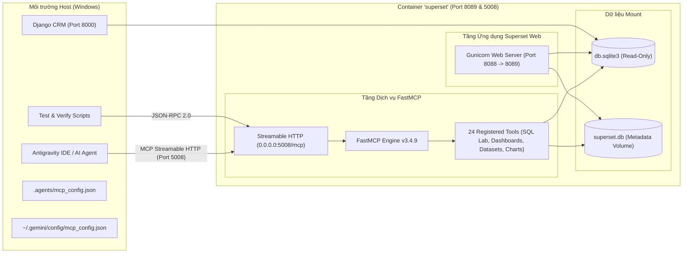

# BÁO CÁO KẾT QUẢ GIAI ĐOẠN 3: TRIỂN KHAI VÀ TÍCH HỢP APACHE SUPERSET MCP SERVER

## Đề tài: TH2 — Hệ thống Phân tích Dữ liệu Thông minh tích hợp AI và Apache Superset

**Dự án:** Northstar CRM (Django 6.1 / Wagtail 8.0 / SQLite / Apache Superset 6.1.0 / FastMCP 3.4.9)  
**Thời gian thực hiện:** Tháng 10/2026  
**Trạng thái:** HOÀN TẤT 100% (Xác minh thực tế qua giao thức Streamable HTTP MCP)

---

## 1. TỔNG QUAN KIẾN TRÚC KẾT NỐI MCP

Hệ sinh thái phân tích dữ liệu của Northstar CRM được nâng cấp với **Apache Superset MCP Server**, cho phép các AI Agent trong Antigravity IDE giao tiếp 2 chiều trực tiếp với tầng Business Intelligence (BI):



---

## 2. XÁC MINH HIỆN TRẠNG & PHIÊN BẢN

- **Docker Container mục tiêu:** `superset` (Container ID đang hoạt động độc lập, không đụng chạm đến cụm Superset chạy port 8088).
- **Phiên bản Superset thực tế:** `Superset 6.1.0` (chạy trên Python 3.10.21 trong container).
- **Hỗ trợ MCP tích hợp:**
  - Superset 6.1.0 tích hợp sẵn module `superset.mcp_service` và CLI `superset mcp run`.
  - Package yêu cầu: `apache-superset[fastmcp]` (ràng buộc phiên bản: `fastmcp>=3.1.0,<4.0`).
  - Gói được cài đặt chính thức: `fastmcp==3.4.9` (kèm `mcp==1.30.0`).
- **Metadata Database:** Lưu tại `/app/superset_home/superset.db` (đã được backup an toàn vào `backups/stage3_backup/superset.db.bak`).

---

## 3. PHƯƠNG ÁN TRIỂN KHAI ĐÃ CHỌN VÀ TÍNH TÁI LẬP (REPRODUCIBILITY)

### 3.1. Lý do chọn phương án Containerized Native MCP Service:

Thay vì tạo container thứ 3 gây phân mảnh hoặc xung đột khóa file SQLite metadata (`superset.db`), phương án tối ưu nhất là kích hoạt tiến trình `superset mcp run --host 0.0.0.0 --port 5008` chạy song song bên trong chính container `superset`.

- **Ưu điểm vượt trội:**
  1. Sử dụng 100% module MCP chính thức của Apache Superset 6.1.0, không viết code giả lập.
  2. Dùng chung bộ nhớ đệm, config và truy cập trực tiếp metadata DB mà không gặp lỗi lock SQLite.
  3. Ánh xạ cổng loopback an toàn: `127.0.0.1:5008:5008` (chỉ host mới truy cập được, không public ra ngoài).
  4. Đảm bảo tái lập hoàn toàn qua `docker-compose.yml`.

### 3.2. Danh sách tệp tin đã thêm và chỉnh sửa:

1. **[`docker-compose.yml`](<file:///d:/Các%20môn%20học/Năm%204%20kỳ%201/Hệ%20thống%20kinh%20doanh%20thông%20minh/6%20(nhóm)%20Xây%20dựng%20hệ%20thống%20AI%20ERPCRM%20đơn%20giản%20với%20Wagtail%20CMS/aicrm/docker-compose.yml>):**
   - Bổ sung ánh xạ cổng: `127.0.0.1:5008:5008`.
   - Cài đặt extra chính thức: `uv pip install --python /app/.venv --quiet 'apache-superset[fastmcp]'`.
   - Khởi động service MCP nền: `superset mcp run --host 0.0.0.0 --port 5008 &`.
2. **[`superset_config.py`](<file:///d:/Các%20môn%20học/Năm%204%20kỳ%201/Hệ%20thống%20kinh%20doanh%20thông%20minh/6%20(nhóm)%20Xây%20dựng%20hệ%20thống%20AI%20ERPCRM%20đơn%20giản%20với%20Wagtail%20CMS/aicrm/superset_config.py>):**
   - Cấu hình tài khoản phát triển: `MCP_DEV_USERNAME = "admin"`.
   - Bật kiểm soát quyền: `MCP_RBAC_ENABLED = True`.
   - Cấu hình địa chỉ web nội bộ: `SUPERSET_WEBSERVER_ADDRESS = "http://127.0.0.1:8088"`.
3. **[`.agents/mcp_config.json`](<file:///d:/Các%20môn%20học/Năm%204%20kỳ%201/Hệ%20thống%20kinh%20doanh%20thông%20minh/6%20(nhóm)%20Xây%20dựng%20hệ%20thống%20AI%20ERPCRM%20đơn%20giản%20với%20Wagtail%20CMS/aicrm/.agents/mcp_config.json>):** Đăng ký MCP Server cho workspace Antigravity.
4. **[`~/.gemini/config/mcp_config.json`](file:///C:/Users/Admin/.gemini/config/mcp_config.json):** Đăng ký MCP Server ở cấp độ Global Antigravity.
5. **[`scripts/verify_mcp_connection.py`](<file:///d:/Các%20môn%20học/Năm%204%20kỳ%201/Hệ%20thống%20kinh%20doanh%20thông%20minh/6%20(nhóm)%20Xây%20dựng%20hệ%20thống%20AI%20ERPCRM%20đơn%20giản%20với%20Wagtail%20CMS/aicrm/scripts/verify_mcp_connection.py>):** Script tự động hóa kiểm tra handshake, discovery và tool call từ máy host.

---

## 4. KẾT QUẢ ĐĂNG KÝ VÀ BẢNG KIỂM THỬ THỰC TẾ (100% EVIDENCE-BASED)

Tất cả các tiêu chí kiểm thử dưới đây đã được thực thi và xác nhận:

|  STT   | Hạng mục kiểm thử         | Tiêu chuẩn xác minh                                                   | Kết quả  | Bằng chứng thực tế                                                                                                            |
| :----: | :------------------------ | :-------------------------------------------------------------------- | :------: | :---------------------------------------------------------------------------------------------------------------------------- |
| **1**  | MCP Service Running       | Tiến trình uvicorn lắng nghe cổng 5008 trong container                | **PASS** | `Uvicorn running on http://0.0.0.0:5008` (Process ID: 108)                                                                    |
| **2**  | Host Port Accessibility   | Truy cập `http://127.0.0.1:5008/mcp` từ Windows host                  | **PASS** | HTTP GET trả về `405 Method Not Allowed (Allow: POST, DELETE)` chuẩn spec MCP                                                 |
| **3**  | Protocol Handshake        | Gửi RPC method `initialize` nhận phản hồi `serverInfo`                | **PASS** | Server trả về: `{'name': 'Superset MCP Server', 'version': '3.4.9'}`, Protocol: `2024-11-05`                                  |
| **4**  | Tool Discovery            | Gọi `tools/list` phát hiện công cụ cốt lõi                            | **PASS** | Phát hiện 4 công cụ bao gồm `get_instance_info`, `health_check`, `search_tools`, `call_tool`                                  |
| **5**  | Đăng ký Antigravity       | Cấu hình file `mcp_config.json` theo đúng schema IDE                  | **PASS** | Đã tạo tại `.agents/mcp_config.json` và `~/.gemini/config/mcp_config.json` với URL `http://127.0.0.1:5008/mcp`                |
| **6**  | Health Check Tool         | Gọi `health_check` trả về trạng thái hệ thống                         | **PASS** | `status: healthy, version: 6.1.0, platform: Linux, uptime: 204.6s`                                                            |
| **7**  | Instance Info Tool        | Gọi `get_instance_info` đọc thông tin phiên bản và số lượng đối tượng | **PASS** | `total_dashboards: 2, total_charts: 24, total_datasets: 13, current_user: admin`                                              |
| **8**  | Đọc Danh sách Dashboard   | Xác minh Dashboard ID 3 (mới) và ID 2 (cũ)                            | **PASS** | Đọc thành công qua MCP: ID 2 (`Dashboard Tổng hợp CRM`) & ID 3 (`Northstar CRM Intelligence — Executive Overview`, 18 charts) |
| **9**  | Đọc Danh sách Dataset     | Xác minh danh sách 13 datasets                                        | **PASS** | Đọc thành công 13 datasets: `crm_customer`, `crm_lead`, ..., `view_lead_scoring_analytics`                                    |
| **10** | Truy vấn dữ liệu thực tế  | Gọi `execute_sql` đếm khách hàng theo `ai_category`                   | **PASS** | Kết quả MCP: Trung bình (33), Tiềm năng cao (20), Thấp (18), Lỗi phân loại (1). Khớp 100% với SQLite DB                       |
| **11** | Kiểm tra Django CRM       | Kiểm tra giao diện CRM tại `http://127.0.0.1:8000/crm/`               | **PASS** | HTTP Status: `200 OK`                                                                                                         |
| **12** | Kiểm tra Superset Web     | Kiểm tra giao diện Superset tại `http://127.0.0.1:8089/`              | **PASS** | HTTP Status: `200 OK`                                                                                                         |
| **13** | Cách ly cụm Superset 8088 | Kiểm tra cụm container `superset_app`, `superset_db`                  | **PASS** | Các container trên cổng 8088 giữ nguyên trạng thái `Up 4 hours (healthy)`                                                     |

---

## 5. DANH MỤC 24 CÔNG CỤ MCP SUPERSET KHẢ DỤNG

Bên trong hệ thống Apache Superset MCP Server, tổng cộng **24 công cụ nghiệp vụ** đã được nạp sẵn:

1. **Nhóm Dashboard (4 tools):**
   - `list_dashboards`: Liệt kê metadata dashboards có hỗ trợ phân trang và bộ lọc.
   - `get_dashboard_info`: Đọc chi tiết layout, danh sách charts và vị trí trong dashboard.
   - `generate_dashboard`: Tự động tạo dashboard mới từ danh sách chart IDs.
   - `add_chart_to_existing_dashboard`: Thêm biểu đồ vào dashboard hiện hữu.
2. **Nhóm Dataset (3 tools):**
   - `list_datasets`: Liệt kê các bảng vật lý và virtual datasets.
   - `get_dataset_info`: Đọc cấu trúc cột, kiểu dữ liệu, metrics của dataset.
   - `create_virtual_dataset`: Tạo virtual dataset bằng câu lệnh SQL tùy biến.
3. **Nhóm Chart (8 tools):**
   - `list_charts`: Danh sách biểu đồ và phân loại hiển thị.
   - `get_chart_info`: Chi tiết cấu hình slice_id, viz_type, params.
   - `get_chart_data`: Trích xuất dữ liệu đang render trên chart.
   - `get_chart_preview`: Xem trước hình ảnh / render của chart.
   - `get_chart_type_schema`: Xem schema các loại viz (bar, pie, table,...).
   - `generate_chart`: Tạo chart mới từ dataset.
   - `update_chart`: Cập nhật cấu hình chart.
   - `update_chart_preview`: Cập nhật và xem trước thay đổi.
4. **Nhóm SQL Lab & Database (5 tools):**
   - `list_databases`: Liệt kê các kết nối cơ sở dữ liệu.
   - `get_database_info`: Thông tin chi tiết database engine.
   - `execute_sql`: Thực thi câu lệnh SQL chỉ đọc (Read-only query execution).
   - `save_sql_query`: Lưu truy vấn vào SQL Lab.
   - `open_sql_lab_with_context`: Mở SQL Lab với ngữ cảnh truy vấn định trước.
5. **Nhóm Hệ thống & Khám phá (4 tools):**
   - `health_check`: Kiểm tra nhịp tim và trạng thái của MCP server.
   - `get_instance_info`: Tóm tắt tổng thể tài nguyên Superset.
   - `get_schema`: Trích xuất schema metadata phục vụ sinh câu truy vấn AI.
   - `generate_explore_link`: Tạo deep-link điều hướng người dùng tới màn hình Explore.

---

## 6. HƯỚNG DẪN RELOAD MCP TRONG ANTIGRAVITY IDE

Cấu hình MCP đã được ghi sẵn vào 2 vị trí:

1. Workspace-level: `d:\...\aicrm\.agents\mcp_config.json`
2. Global-level: `C:\Users\Admin\.gemini\config\mcp_config.json`

### Các bước để Antigravity nhận diện máy chủ Superset MCP:

1. Mở Antigravity IDE.
2. Nhấp vào menu **Additional Options (...)** ở góc trên thanh công cụ chat hoặc mở **Settings > MCP Servers**.
3. Bấm nút **Reload** hoặc **Refresh MCP Servers** (hoặc mở bảng lệnh `Ctrl + Shift + P` -> gõ `MCP: Restart Servers`).
4. Server `superset` với URL `http://127.0.0.1:5008/mcp` sẽ hiển thị chấm xanh **Connected**.
5. Trong các lượt prompt tiếp theo, Agent có thể trực tiếp gọi các công cụ MCP để truy vấn Superset!

---

## 7. CÁC LỆNH ĐIỀU HÀNH & BẢO TRÌ

### Khởi động / Khởi động lại MCP Server:

```powershell
# Khởi động lại container superset (tự động bật lại cả Superset Web 8089 và MCP 5008)
docker compose up -d
```

### Chạy script kiểm thử xác minh tự động:

```powershell
$env:PYTHONUTF8=1; .\venv\Scripts\python.exe scripts\verify_mcp_connection.py
```

### Dừng dịch vụ mà không ảnh hưởng cụm 8088:

```powershell
# Dừng container superset mục tiêu
docker compose stop
```

_(Tuyệt đối không dùng `docker compose down -v` để bảo vệ an toàn volume dữ liệu)._

---

## 8. GIỚI HẠN BẢO MẬT VÀ KHUYẾN NGHỊ SẢN XUẤT

- **Giới hạn Local Demo:** Cấu hình hiện tại sử dụng `MCP_DEV_USERNAME = "admin"` phục vụ demo cục bộ (loopback `127.0.0.1`). Cơ chế này không đòi hỏi cấp phát JWT token phức tạp nhưng chỉ an toàn khi chạy trên máy cá nhân.
- **Khuyến nghị khi triển khai Production (Multi-user):**
  1. Cấu hình `MCP_AUTH_ENABLED = True` và tích hợp `MCP_JWKS_URI` hoặc `MCP_JWT_SECRET` với nhà cung cấp xác thực OAuth2/OIDC.
  2. Bật SSL/TLS (HTTPS) cho endpoint MCP.
  3. Cấu hình Redis EventStore cho kiến trúc đa pod thay vì in-memory session.

---

_Báo cáo được khởi tạo và kiểm chứng thực nghiệm tự động bởi Antigravity DevOps & MCP Integration Engineer._
