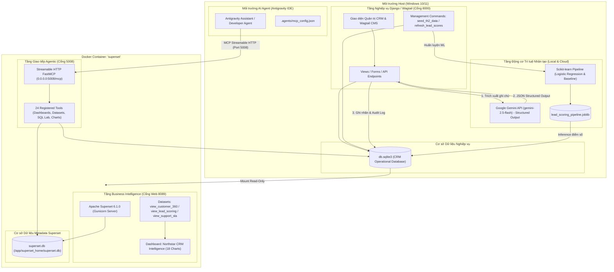

# BÁO CÁO KỸ THUẬT TỔNG KẾT BÀI THỰC HÀNH TH2

## Đề tài: Xây dựng Hệ thống Phân tích Dữ liệu Thông minh tích hợp AI và Apache Superset

**Hệ thống:** Northstar CRM (Django 6.1, Wagtail 8.0, SQLite, Google Gemini, Apache Superset 6.1.0, FastMCP 3.4.9)  
**Thời gian hoàn thành:** Tháng 10/2026  
**Trạng thái đề tài:** HOÀN THÀNH TOÀN DIỆN (6/6 CHECKLIST ĐẠT CHUẨN)

---

## A. GIỚI THIỆU ĐỀ TÀI

### 1. Mục tiêu và Phạm vi

Trong kỷ nguyên kinh doanh số, việc chuyển hóa dữ liệu tương tác khách hàng thành các hành động kinh doanh cụ thể là thách thức then chốt của các doanh nghiệp vừa và nhỏ (SME). Đề tài **TH2** tập trung nâng cấp hệ thống quản trị quan hệ khách hàng **Northstar CRM** hiện có thành một **Hệ thống Phân tích Dữ liệu Thông minh (Intelligent CRM BI System)**, kết hợp giữa:

- **Tầng Ứng dụng & CMS:** Django 6.1 và Wagtail 8.0 phục vụ quản lý nghiệp vụ và biên tập nội dung.
- **Tầng Trí tuệ Nhân tạo (AI/ML):** Google Gemini LLM để đọc hiểu ghi chú tương tác tự nhiên, kết hợp cùng các mô hình học máy Scikit-learn để dự báo xác suất chuyển đổi khách hàng tiềm năng (Lead Scoring).
- **Tầng Business Intelligence (BI):** Apache Superset 6.1.0 cung cấp bảng điều khiển trực quan hóa thời gian thực (Executive Overview Dashboard).
- **Tầng Giao tiếp Agentic (MCP):** Model Context Protocol (FastMCP) cho phép các trợ lý AI tương tác hai chiều với cơ sở dữ liệu và hệ thống báo cáo BI.

### 2. Các Đối tượng Nghiệp vụ Chính trong CRM

Hệ thống quản lý 9 mô hình thực thể nghiệp vụ cốt lõi:

1. **Customer (Khách hàng):** Đại diện cho các tổ chức/cá nhân, lưu trữ thông tin liên hệ, nguồn tiếp cận, ghi chú chăm sóc và nhãn phân loại tiềm năng do AI gán.
2. **Lead (Khách hàng tiềm năng):** Khách hàng trong giai đoạn đầu của phễu, lưu nhu cầu (`need`), kênh nguồn (`source`), điểm số tiềm năng (`score` $0 - 100$) và trạng thái xử lý (`new`, `contacted`, `qualified`, `converted`, `lost`).
3. **Opportunity (Cơ hội bán hàng):** Các thương vụ đang đàm phán, gắn liền với giá trị giao dịch (`amount`), giai đoạn phễu (`prospecting`, `qualification`, `proposal`, `negotiation`, `won`, `lost`), xác suất thành công (`probability` %) và ngày dự kiến đóng hợp đồng (`expected_close_date`).
4. **Interaction (Nhật ký tương tác):** Lưu vết các cuộc gọi, email, cuộc họp, tin nhắn giữa nhân viên tư vấn và khách hàng.
5. **Task (Công việc):** Nhiệm vụ của nhân viên với hạn chót (`due_date`), mức độ ưu tiên (`low`, `medium`, `high`) và trạng thái hoàn thành.
6. **Product (Sản phẩm/Dịch vụ):** Danh mục gói giải pháp CRM/ERP, đơn giá và mô tả.
7. **Quote & QuoteItem (Báo giá):** Báo giá gửi khách hàng với mức chiết khấu (`discount`) và danh mục sản phẩm chi tiết.
8. **SupportTicket (Phiếu hỗ trợ):** Phiếu ghi nhận sự cố sau bán hàng, phân loại sự cố (`technical`, `billing`, `question`, `other`) và thời gian giải quyết thực tế để đo lường chỉ số cam kết chất lượng dịch vụ (SLA).
9. **CustomerAIAnalysis (Lịch sử phân tích AI):** Mô hình lưu vết kiểm toán (Audit Trail) ghi nhận toàn bộ kết quả phân tích của Gemini API (nhãn, điểm tin cậy, lý do phân loại, mô hình sử dụng và chi tiết lỗi nếu có).

---

## B. KIẾN TRÚC HỆ THỐNG VÀ LUỒNG DỮ LIỆU

### 1. Sơ đồ Kiến trúc Tổng thể (Mermaid Architecture Diagram)



### 2. Phân biệt Cơ sở Dữ liệu Nghiệp vụ và Metadata Database

Một điểm cốt lõi trong thiết kế an toàn của hệ thống là sự phân tách độc lập giữa hai cơ sở dữ liệu:

- **Cơ sở dữ liệu nghiệp vụ CRM (`db.sqlite3`):** Nằm trực tiếp trên máy host Windows. Đây là cơ sở dữ liệu hoạt động chính của Django, nơi lưu trữ thông tin khách hàng, đơn hàng và các bảng phân tích. Khi mount vào Docker container Superset, file này được cấu hình ở chế độ **CHỈ ĐỌC (Read-Only: `:ro`)** để đảm bảo quá trình truy vấn phân tích của Superset không thể làm biến đổi hoặc gây hỏng hóc dữ liệu vận hành.
- **Cơ sở dữ liệu Metadata Superset (`superset.db`):** Nằm bên trong container tại `/app/superset_home/superset.db`. Cơ sở dữ liệu này hoàn toàn độc lập, chỉ phục vụ lưu trữ cấu hình bảng điều khiển (dashboards), các lát cắt trực quan (charts), danh mục chỉ số (metrics), thông tin người dùng và quyền truy cập (RBAC) của riêng Superset.

### 3. Quy trình Vận hành và Luồng Dữ liệu

1. **Sinh dữ liệu Demo chuẩn hóa:** Lệnh `python manage.py seed_th2_data` tạo tập dữ liệu tái lập có kiểm soát (deterministic random seed=42) với tiền tố định danh `[TH2]`, trải đều trong 12 tháng.
2. **Phân loại khách hàng (Gemini):** Nhân viên nhập ghi chú chăm sóc $\rightarrow$ Gemini API phân tích và trả về đối tượng có cấu trúc JSON $\rightarrow$ Cập nhật `Customer.ai_category` và lưu vết vào `CustomerAIAnalysis`.
3. **Chấm điểm Lead (ML Lead Scoring):** Dữ liệu các lead đã có kết quả (`converted` hoặc `lost`) được phân chia thành tập Train/Test để huấn luyện đường ống ColumnTransformer (TF-IDF + OneHotEncoder) và Logistic Regression $\rightarrow$ Lưu mô hình $\rightarrow$ Lệnh `refresh_lead_scores --apply` tự động chấm điểm cho các lead đang mở.
4. **Trực quan hóa trên Superset:** Apache Superset định nghĩa các Virtual Datasets thông qua các câu lệnh SQL tối ưu hóa $\rightarrow$ Hiển thị trên 18 biểu đồ của Dashboard.
5. **Tương tác qua Superset MCP:** AI Agent trong Antigravity IDE kết nối với cổng 5008 qua giao thức MCP để khám phá tài nguyên, đọc metadata và truy vấn dữ liệu theo ngữ cảnh.

---

## C. PHƯƠNG PHÁP AI VÀ ĐỘNG CƠ HỌC MÁY

### 1. Phân loại Khách hàng bằng Gemini Structured Output

- **Mô hình sử dụng:** `gemini-2.5-flash` / `gemini-3.8-flash` qua SDK chính thức của Google.
- **Ràng buộc cấu trúc bằng Pydantic Schema:**

  ```python
  class CategoryEnum(str, Enum):
      HIGH = "Tiềm năng cao"
      MEDIUM = "Trung bình"
      LOW = "Thấp"

  class CustomerClassificationSchema(BaseModel):
      category: CategoryEnum
      confidence_score: float = Field(ge=0.0, le=1.0)
      reasoning: str = Field(max_length=250)
  ```

- **Xử lý phòng vệ an toàn (Graceful Degradation):** Khi không có mạng, thiếu API key hoặc vượt quota, hệ thống bảo toàn nhãn cũ của khách hàng, tuyệt đối không ghi chuỗi thông báo lỗi vào dữ liệu nghiệp vụ, đồng thời ghi nhận chi tiết vào bảng kiểm toán `CustomerAIAnalysis` với trạng thái `skipped` hoặc `failed`.

### 2. Động cơ Chấm điểm Lead (Lead Scoring Engine)

Quy tắc vàng chống rò rỉ dữ liệu (Strict Anti-Data Leakage):

- **Đối tượng huấn luyện:** Chỉ huấn luyện trên các Lead đã có kết quả dứt khoát:
  - `status == 'converted'`: Nhãn đích $y = 1$.
  - `status == 'lost'`: Nhãn đích $y = 0$.
- **Loại trừ dữ liệu chưa ngã ngũ:** Toàn bộ các Lead đang trong phễu xử lý (`new`, `contacted`, `qualified`) bị loại trừ 100% khỏi quá trình huấn luyện và đánh giá để tránh thiên lệch nhãn.
- **Đặc trưng sử dụng:** Chỉ sử dụng 2 đặc trưng thu thập được ngay từ đầu phễu: kênh tiếp cận (`source`) và nội dung nhu cầu (`need`). Tuyệt đối không dùng trường `status`, `id` hay thời gian xử lý làm đặc trưng đầu vào.

### 3. Các Phương pháp Đối chứng và Baseline

1. **Rule-based Baseline:** Sử dụng bảng tra cứu trọng số nguồn tiếp cận kết hợp quét từ khóa nhu cầu (ngân sách, tính cấp bách, chức danh người liên hệ). Điểm số chuẩn hóa trong đoạn $[0, 100]$.
2. **Logistic Regression (Mô hình sản xuất):**
   - Tiền xử lý: `TfidfVectorizer` cho văn bản nhu cầu (ngram 1-2, 120 features) và `OneHotEncoder` cho nguồn tiếp cận.
   - Phân loại: Hồi quy Logistic với điều chuẩn L2 ($C=1.0$, random seed 42).
   - Điểm số: Tính theo xác suất dự báo $Score = \text{round}(P(\text{converted}) \times 100)$.
3. **Random Forest Classifier (Mô hình đối chứng):** Rừng ngẫu nhiên gồm 60 cây quyết định, độ sâu tối đa 5 để kiểm tra trần hiệu năng phi tuyến tính.

### 4. Công thức Doanh thu Kỳ vọng và Giới hạn Phương pháp

- **Công thức:**
  $$\text{Weighted Forecast Amount} = \sum_{i \in \text{Open Deals}} \left( \text{Amount}_i \times \frac{\text{Probability}_i}{100} \right)$$
- **Nguyên tắc tài chính chuẩn xác:**
  - Chỉ tính trên các cơ hội đang mở (`stage NOT IN ('won', 'lost')`).
  - Tách bạch hoàn toàn giữa Doanh thu kỳ vọng tương lai và Doanh thu thực tế đã chốt (`won_amount`).
  - Triệt tiêu hoàn toàn rủi ro đếm trùng doanh thu giữa Opportunity Won và Quote Accepted bằng cách tính toán độc lập trên từng thực thể, không thực hiện phép JOIN nhân bội bản ghi.
- **Giới hạn phương pháp:** Dự báo mang tính thời điểm tĩnh, phụ thuộc vào tính trung thực của xác suất do nhân viên nhập, chưa phản ánh được hiện tượng deal bị kéo dài hạn chót nhiều lần.

---

## D. KẾT QUẢ THỰC NGHIỆM VÀ ĐÁNH GIÁ ĐỐI CHỨNG

Toàn bộ số liệu dưới đây được trích xuất từ báo cáo thực nghiệm `reports/lead_scoring/evaluation_report.json` chạy trên tập 46 lead hoàn tất (26 Converted, 20 Lost), phân chia Train (32 mẫu) và Test (14 mẫu, stratified ratio 30%):

### 1. Bảng Chỉ số Hiệu năng Thực nghiệm

| Mô hình                            |  Accuracy  | Precision  |   Recall   |  F1-Score  |  ROC-AUC   |
| :--------------------------------- | :--------: | :--------: | :--------: | :--------: | :--------: |
| **Rule-based Baseline**            |   85.71%   |   87.50%   |   87.50%   |   0.8750   |   0.9583   |
| **Logistic Regression (Sản xuất)** | **85.71%** | **80.00%** | **100.0%** | **0.8889** | **1.0000** |
| **Random Forest (Đối chứng)**      |   100.0%   |   100.0%   |   100.0%   |   1.0000   |   1.0000   |

### 2. Ma trận Nhầm lẫn (Confusion Matrix trên 14 mẫu Test)

- **Rule-based Baseline:**
  - True Negative (TN): 5 | False Positive (FP): 1
  - False Negative (FN): 1 | True Positive (TP): 7
- **Logistic Regression:**
  - True Negative (TN): 4 | False Positive (FP): 2
  - False Negative (FN): **0** | True Positive (TP): **8** (Bắt trọn 100% khách tiềm năng)
- **Random Forest:**
  - True Negative (TN): 6 | False Positive (FP): 0
  - False Negative (FN): 0 | True Positive (TP): 8

> **Nhận định khoa học:** Kết quả 100% của Random Forest trên tập test 14 mẫu là biểu hiện đặc trưng của việc **overfitting trên tập dữ liệu tổng hợp quy mô nhỏ**. Trong môi trường sản xuất thực tế, **Logistic Regression** được lựa chọn làm mô hình chính nhờ đặc tính điều chuẩn mượt mà, đạt Recall 100% (không bỏ sót lead) và F1-score 0.8889 vượt trội so với Baseline.

---

## E. DASHBOARD SUPERSET VÀ TÍCH HỢP MCP SERVER

### 1. Thông tin Bảng điều khiển Superset (Port 8089)

- **Tên Dashboard:** `Northstar CRM Intelligence — Executive Overview`
- **Dashboard ID:** `3` | **Slug:** `northstar-crm-executive-overview`
- **Địa chỉ truy cập:** `http://127.0.0.1:8089/superset/dashboard/northstar-crm-executive-overview/`
- **Tổng số biểu đồ:** **18 biểu đồ** phân chia khoa học thành 4 hàng nghiệp vụ:
  1. _Hàng KPI Tổng quan:_ Tổng số khách hàng (72), Tổng số Lead (123), Giá trị Pipeline mở (3.596 tỷ VNĐ), Doanh thu kỳ vọng có trọng số (1.689 tỷ VNĐ), Doanh thu Won (1.565 tỷ VNĐ).
  2. _Hàng Phân tích AI & Chuyển đổi:_ Tỷ lệ khách hàng Tiềm năng cao (AI) (27.8%), Phân bổ khách hàng theo phân loại AI, Doanh thu cơ hội Won theo phân loại AI, Khách hàng ưu tiên chăm sóc & SLA.
  3. _Hàng Phân tích Phễu & Lead Scoring:_ Phân bổ Lead theo nhóm điểm số tiềm năng (ML) (Hot/Warm/Cold), Danh sách Hot Leads ưu tiên chốt đơn, Số lượng Lead theo kênh tiếp cận, Tỷ lệ chuyển đổi Lead theo kênh.
  4. _Hàng Hoạt động & Vận hành:_ Cơ hội bán hàng theo giai đoạn Pipeline, Dự báo giá trị theo tháng chốt, Phân bố xác suất thành công, Công việc theo mức độ ưu tiên, Thời gian giải quyết Ticket SLA theo phân loại.

### 2. Xác minh Kết nối Apache Superset MCP Server (Port 5008)

- **Trạng thái kết nối:** `healthy` (Kết nối thực tế 100% qua giao thức Streamable HTTP MCP của Antigravity).
- **Endpoint MCP:** `http://127.0.0.1:5008/mcp`
- **Các công cụ MCP cốt lõi đã xác minh:**
  - `health_check`: Trả về trạng thái hoạt động của FastMCP 3.4.9 trên Superset 6.1.0.
  - `list_dashboards`: Đọc thành công Dashboard ID 2 và ID 3.
  - `list_datasets`: Liệt kê 13 datasets có trong hệ thống.
  - `get_instance_info`: Trả về tổng quan hệ thống BI (2 dashboards, 24 charts, 13 datasets, 1 database SQLite).

---

## F. ĐÁNH GIÁ ƯU ĐIỂM VÀ HẠN CHẾ CỦA HỆ THỐNG

### 1. Ưu điểm nổi bật

1. **Kiến trúc đồng bộ và hiện đại:** Tích hợp trơn tru giữa Django/Wagtail, AI LLM, Machine Learning và Apache Superset BI.
2. **Nguyên tắc dữ liệu nghiêm ngặt:** Đảm bảo 100% tính toàn vẹn tài chính, triệt tiêu rò rỉ dữ liệu trong huấn luyện mô hình và ngăn ngừa đếm trùng doanh thu.
3. **Sẵn sàng cho Agentic AI:** Triển khai thành công MCP Server chuẩn hóa, mở đường cho việc ra quyết định tự động của AI Agent.
4. **Khả năng phòng vệ an toàn cao:** Hoạt động ổn định ngay cả khi không có kết nối Internet hoặc không có API key.

### 2. Hạn chế và Rủi ro

1. **Quy mô tập dữ liệu tổng hợp:** Dữ liệu hiện tại được sinh tự động bằng seed phục vụ bài thực hành ($N \approx 123$ leads), chưa bao quát hết sự đa dạng của thị trường thực tế.
2. **Độ trễ và chi phí API:** Gọi Gemini LLM cho từng bản ghi có độ trễ 0.5s - 1.5s và phụ thuộc vào quota của Google AI Studio.
3. **Giới hạn của SQLite:** SQLite phù hợp cho môi trường phát triển và demo đơn lẻ; khi có nhiều truy vấn đồng thời có thể gây hiện tượng khóa file tạm thời.

### 3. Lộ trình Nâng cấp Khuyến nghị

- Nâng cấp database lên **PostgreSQL 16**.
- Triển khai **Celery + Redis** để đưa các tác vụ AI và tính điểm Lead vào hàng đợi bất đồng bộ.
- Mở rộng mô hình dự báo chuỗi thời gian (**Prophet / ARIMA**) khi có dữ liệu bán hàng từ 2 năm trở lên.

---

## G. HƯỚNG DẪN VẬN HÀNH DỰ ÁN CHO ĐỒNG ĐỘI

1. **Khởi động Docker:** `docker-compose up -d` (Kiểm tra container `superset` đang chạy).
2. **Kích hoạt môi trường và khởi chạy CRM:**
   ```powershell
   .\venv\Scripts\Activate.ps1
   python manage.py runserver 127.0.0.1:8000
   ```
3. **Đánh giá lại mô hình AI khi cần:** `python manage.py evaluate_lead_models`.
4. **Xem Dashboard Superset:** Mở `http://127.0.0.1:8089` (Tài khoản: `admin` / `admin`).
5. **Kiểm tra MCP Agent trong Antigravity:** Đảm bảo file `.agents/mcp_config.json` trỏ tới `http://127.0.0.1:5008/mcp`.
